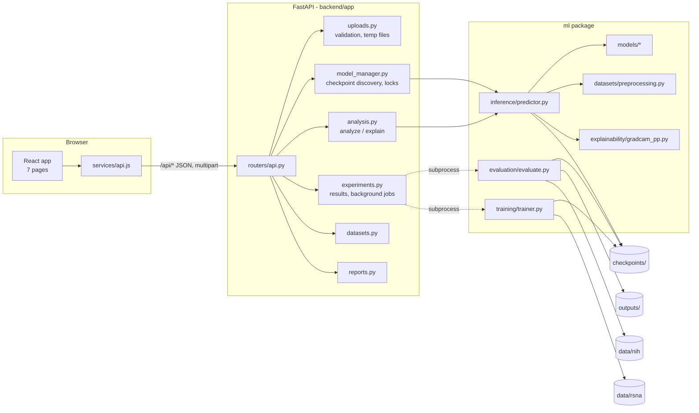

# System Architecture

Three layers, one direction of dependency: **frontend → backend (REST) → `ml` package → files on disk**.
The `ml` package never imports the backend or frontend and works on its own from the command line.
Model internals are described in [ML_ARCHITECTURE.md](ML_ARCHITECTURE.md).

## 1. Components

| Layer | Path | Responsibility |
|---|---|---|
| Configuration | `ml/configs/*.yaml`, `ml/utils/config.py`, `.env` | YAML with `_base_` inheritance; `.env` / environment variables override data roots, checkpoint/output roots and device; CLI `key=value` overrides win |
| Data | `ml/datasets/` | DICOM/PNG loading, preprocessing, box→mask, augmentation, RSNA patient splits, NIH external set, DataLoaders |
| Models | `ml/models/` | hybrid + 4 baselines behind one `build_model()`; uniform output dict |
| Training | `ml/training/` | loss, generic `Trainer`, one entry script per model |
| Checkpoints | `ml/utils/checkpoints.py` | **single registry** of locations used by training, evaluation, inference and the API; strict loading |
| Evaluation | `ml/evaluation/` | metrics modules + `evaluate.py` driver |
| Explainability | `ml/explainability/` | Grad-CAM++, overlays, panels |
| Inference | `ml/inference/` | `PneumoniaPredictor` (prediction, MC-dropout uncertainty, abstention, OOD, quality checks, maps) |
| API | `backend/app/` | REST endpoints, validation, concurrency, reports, job runner |
| UI | `frontend/src/` | pages, layered image viewer, charts; all requests go through `services/api.js` |

## 2. Artefact locations (one source of truth)

| Artefact | Written by | Read by |
|---|---|---|
| `data/rsna/splits/rsna_patient_splits.csv` | `prepare_rsna.py` (or first training run) | training, evaluation, API dataset status |
| `data/rsna/cache_384_clahe/` | `prepare_rsna.py --cache` | training/evaluation when `data.rsna.cache_dir` is set |
| `checkpoints/{hybrid,baselines}/<key>_{best,last}.pth` | `ml/training/trainer.py` | evaluation, inference, API, `model_status.py` |
| `checkpoints/calibration/temperature_scaling.json` | `evaluate.py` (RSNA val) | predictor (only if it matches the checkpoint) |
| `checkpoints/calibration/<key>_ood_stats.npz` | `evaluate.py --fit-ood` | predictor (only if it matches the checkpoint) |
| `outputs/logs/<key>_training_log.csv` | trainer | Research Experiments page |
| `outputs/metrics/<key>_metrics.json`, `outputs/predictions/*.csv` | `evaluate.py` | Experiments page, Model Lab, reports, `compare_models.py` |
| `outputs/reports/*.json` | prepare scripts, compare/ablation, benchmark, model_status | Experiments page, Dataset page |
| `outputs/visualizations/*.png` | `evaluate.py`, `explain_image.py` | you / your thesis |
| `outputs/analyses/<id>/` | API `/analyze` | recent analyses, reports |

`RFRR_CHECKPOINT_ROOT` / `RFRR_OUTPUT_ROOT` move these roots consistently for every component (the tests check that
training and inference resolve the same paths).

## 3. Request flow: analysing an X-ray

1. **Browser**: client-side checks (extension, ≤ 25 MB) → `POST /api/analyze` (XHR with upload progress).
2. **uploads.py**: stream to a private temp file; extension whitelist; PNG/JPEG/DICOM signature; PIL `verify()` or
   DICOM header; size and pixel limits → 415/413/422 on failure.
3. **model_manager.py**: resolve the model (request → active → default → first trained); load lazily with
   `load_trained_model` (strict; 409 `model_not_trained` if absent); one lock per model.
4. **predictor.py**: preprocessing identical to training → forward pass → probability; temperature scaling and threshold
   from the calibration file *if fitted on this checkpoint*; MC-dropout uncertainty; quality checks; Mahalanobis OOD;
   abstention decision; localization map, attention map, Grad-CAM++.
5. **analysis.py / imaging.py**: maps → transparent PNG layers (viridis / inferno / cividis, smooth alpha); zone
   summaries; record saved without the original file. The temp file is deleted in `finally`.
6. **Browser**: result cards and layered viewer (tabs, zoom, compare, opacity, legends); report link.

`/api/explain` adds reference boxes (provided, or looked up from the RSNA CSV by file name) mapped through the same
resize geometry, plus IoU, Dice, pointing game, mass-in-box and attention alignment.

## 4. Concurrency and long jobs

* Inference runs in FastAPI's thread pool; each model has its own lock (Grad-CAM++ hooks are not re-entrant).
* Evaluations, training, comparisons and dataset preparation run as **separate OS processes** started from the
  Research Experiments page (one at a time, never automatically). The API stays responsive. When a job ends, cached
  models are reloaded so new calibration files take effect.

## 5. Safety rules enforced in code

* No random or ImageNet-only weights at inference: missing checkpoint → explicit error / disabled UI.
* No fabricated values: the UI only renders numbers returned by the API, which reads them from files.
* Calibration, threshold and OOD statistics are bound to the checkpoint they were fitted on.
* Uploaded originals are never stored; absolute server paths are never returned.
* Disclaimer on every page, response and report; outcome wording avoids "diagnosis".
